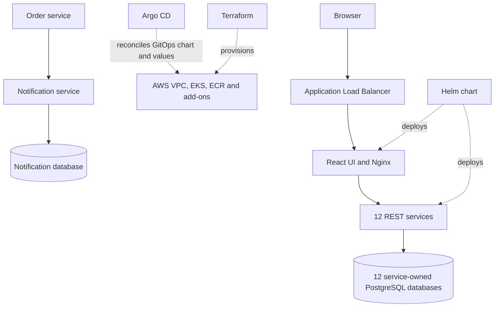

# Lumaire — eCommerce Platform v1.0.4

Lumaire is an AWS EKS based eCommerce application composed of a React storefront and 12 REST services. Each service owns a PostgreSQL database. Helm packages the application, Terraform provisions the AWS foundation, and Argo CD can reconcile a separate GitOps repository onto the cluster.

## Contents

- [Architecture](#architecture)
- [Services and API routes](#services-and-api-routes)
- [Repository layout](#repository-layout)
- [Requirements](#requirements)
- [Provision AWS infrastructure](#provision-aws-infrastructure)
- [Destroy AWS infrastructure](#destroy-aws-infrastructure)
- [Deploy the application](#deploy-the-application)
- [Build and release workflow](#build-and-release-workflow)
- [CI security setup](#ci-security-setup)
- [Verify the deployment](#verify-the-deployment)
- [API examples](#api-examples)
- [Configuration and operations](#configuration-and-operations)

## Architecture



The browser accesses the React single-page application through an AWS Application Load Balancer. Nginx serves the static frontend and reverse-proxies `/api/*` requests to Kubernetes services. The API services use separate PostgreSQL databases and communicate with other services over HTTP where needed. The order service sends customer notifications through the notification service's HTTP API.

The Helm chart deploys 12 API services, the frontend, and 12 PostgreSQL StatefulSets by default. Database volumes use the `gp3` StorageClass and request 5 GiB each by default. The chart configures two replicas for the main API services and frontend, plus PodDisruptionBudgets; database StatefulSets run one replica each.

## Services and API routes

Nginx removes the `/api/<name>` prefix before forwarding requests. For example, `GET /api/catalog/products` reaches `catalog-service:8082/products`. The service ports below are cluster-internal; public traffic should enter through the frontend ingress.

| Service | Runtime | Port | Database | Main responsibility / route examples |
|---|---|---:|---|---|
| Auth | Java 21, Spring Boot | 8081 | `auth-db` | Registration, login, current user: `/api/auth/auth/*` |
| Catalog | Go 1.22 | 8082 | `catalog-db` | Product listing and management: `/api/catalog/products` |
| Inventory | Node.js 20, Express | 8083 | `inventory-db` | Stock lookup, adjustment, reservation and release: `/api/inventory/inventory/*` |
| Orders | Python 3.11, FastAPI | 8084 | `order-db` | Order creation, retrieval and status: `/api/orders/orders/*` |
| Payments | C# .NET 8 | 8085 | `payment-db` | Payment processing and refunds: `/api/payments/payments/*` |
| Notifications | Ruby 3.3, Sinatra | 8086 | `notification-db` | Notification listing and creation: `/api/notifications/notifications` |
| Analytics | PHP 8.3 | 8087 | `analytics-db` | Platform analytics endpoints: `/api/analytics/*` |
| Cart | Python 3.11, FastAPI | 8088 | `cart-db` | Customer carts: `/api/cart/carts/*` |
| Shipping | Python 3.11, FastAPI | 8089 | `shipping-db` | Shipment creation and tracking: `/api/shipping/shipments` |
| Reviews | Python 3.11, FastAPI | 8090 | `reviews-db` | Product reviews and summaries: `/api/reviews/reviews` |
| Promotions | Python 3.11, FastAPI | 8091 | `promotions-db` | Promotion validation and redemption: `/api/promotions/promotions/*` |
| Search | Python 3.11, FastAPI | 8092 | `search-db` | Product search and index management: `/api/search/search` |

All API services expose `GET /health`, available through the corresponding `/api/<name>/health` route. The health-check script checks these endpoints and the frontend.

## Repository layout

```text
.
├── .github/workflows/ci.yml       # Quality gates, image scans, ECR publishing and GitOps PRs
├── argocd/application.yaml        # Argo CD Application for the external GitOps repo
├── database/                      # Per-service SQL schema/reference scripts
├── docs/
│   ├── API-EXAMPLES.md             # Request examples for the added APIs
│   ├── ci-security-setup.md        # GitHub Actions OIDC, ECR and GitOps setup
├── frontend/                      # React 19 + Vite UI, packaged with Nginx
├── helm/ecommerce/                # Kubernetes chart, values and templates
├── guides/                        # CI/CD, Helm, Argo CD and observability guides
├── scripts/health-check.sh        # Checks UI and all 12 API health routes
├── services/                      # API services
├── sonar-project.properties        # SonarQube source scope and project key
├── terraform/
│   ├── environments/dev/           # Development AWS environment
│   └── modules/                   # VPC, IAM, EKS, ECR, ACM and add-ons
└── ARCHITECTURE.md                # Additional architecture notes
```

## Requirements

For the AWS deployment path, have:

- An AWS account and credentials configured for the AWS CLI, with permissions to manage the resources in `terraform/environments/dev`.
- Terraform 1.10 or newer. The configured S3 backend uses native lockfile locking.
- An S3 bucket created before `terraform init`; the bucket name and key are configured in `terraform/environments/dev/backend.tf`.
- AWS CLI, `kubectl`, Helm 3, and network access to the AWS APIs and container registry.
- A SonarQube Server reachable from GitHub Actions, configured with the `SONAR_HOST_URL` repository variable and `SONAR_TOKEN` repository secret. The token must analyze the `ecommerce-platform` and `ecommerce-platform-payment-service` projects.
- GitHub Actions configured with the `AWS_ROLE_ARN` repository variable for short-lived AWS OIDC access, plus `SONAR_HOST_URL` and `SONAR_TOKEN` for SonarQube. The `GITOPS_TOKEN` secret needs permission to create a pull request in `rajkumargudala/ecommerce-gitops`. See [CI security setup](docs/ci-security-setup.md).

The default region is `us-east-1`. Review the Terraform variables and Helm values before provisioning or deploying. The development environment creates billable AWS infrastructure, including EKS worker nodes, NAT, storage, and load balancing.

## Provision AWS infrastructure

The development Terraform environment provisions the VPC and subnets, EKS cluster and managed node group, ECR repository, and ACM certificate. Add-ons are controlled by Terraform variables and include the AWS Load Balancer Controller, EBS CSI StorageClass, Argo CD, and observability components.

1. Confirm the S3 backend bucket exists and update `backend.tf` if your bucket differs.
2. Inspect and apply the Terraform plan:

   ```bash
   aws sts get-caller-identity
   terraform -chdir=terraform/environments/dev init
   terraform -chdir=terraform/environments/dev plan
   terraform -chdir=terraform/environments/dev apply
   ```

3. Configure access to the cluster and confirm its nodes are ready:

   ```bash
   aws eks update-kubeconfig --region us-east-1 --name ecommerce-cluster-dev
   kubectl get nodes
   ```

## Destroy AWS infrastructure

Remove the Argo CD Application while the cluster and AWS Load Balancer Controller are still running. Its resource finalizer deletes the GitOps-managed workloads and gives the controller time to remove the application ALB:

```bash
kubectl delete application ecommerce-platform -n argocd --wait=true
kubectl get ingress -A
```

Wait for the application's Ingress to disappear before destroying the cluster. Then review the destroy plan and apply it:

```bash
terraform -chdir=terraform/environments/dev init
terraform -chdir=terraform/environments/dev plan -destroy -out=/tmp/ecommerce-destroy.tfplan
terraform -chdir=terraform/environments/dev show /tmp/ecommerce-destroy.tfplan
terraform -chdir=terraform/environments/dev apply /tmp/ecommerce-destroy.tfplan
```

Terraform removes the resources recorded in state, including the EKS cluster, ECR repository, networking, and add-ons. The S3 backend bucket is created separately and remains so Terraform can retain its state and lock data. KMS key deletion may remain pending for its configured waiting period. Reapply the infrastructure and confirm the ECR repository exists before pushing to a publishing branch; image publication cannot succeed after ECR has been destroyed.

## Deploy the application

### Prepare image tags

The chart reads image tags from `helm/ecommerce/values.yaml`. CI publishes images to the configured ECR repository with immutable tags in the form `<service>-<commit-sha>-<run-id>-<attempt>`. Before a manual deployment, set the chart values to tags that exist in your registry. CI promotes tags to the GitOps repository; it does not rewrite this source repository's default values.

### Deploy with Helm

Validate and render the chart, then install it into the configured Kubernetes context:

```bash
helm lint helm/ecommerce
helm template ecommerce-platform helm/ecommerce --namespace default
helm upgrade --install ecommerce-platform helm/ecommerce \
  --namespace default --create-namespace
```

For a production or shared cluster, provide an environment-specific values file with image tags, database credentials, and ingress settings instead of relying on the development defaults. The values file currently contains example database passwords; replace them before using the chart beyond an isolated demo environment.

### Deploy with Argo CD

The manifest at [`argocd/application.yaml`](argocd/application.yaml) points to the separate `rajkumargudala/ecommerce-gitops` repository, not this repository's chart. It tracks the `gitops-release-1.0.4` branch at `helm/`; that branch contains the v1.0.4 image tags and deployment chart. Argo CD automatically syncs changes on the tracked branch:

```bash
kubectl apply -f argocd/application.yaml
kubectl get applications -n argocd
```

Pushes to `version-1.0.4` now open a promotion PR to `gitops-release-1.0.4`; pushes to `main` open one to GitOps `main`. Each PR carries the source frontend Deployment and Service templates together with image tag updates, while preserving GitOps values and its other workload-specific templates. This keeps the frontend compatible with its non-root image (UID 101, port 8080, writable `/tmp`, `/var/cache/nginx`, and `/var/run`, and Service port 80 to target port 8080). See [the CI/CD and Argo CD guide](guides/cicd-helm-argocd.md).

## Build and release workflow

The GitHub Actions workflow in `.github/workflows/ci.yml` validates the Helm chart, enforces SonarQube quality gates, scans dependencies and configuration with Trivy, then builds and scans local container images before publishing. It covers the frontend and 12 API services. A CycloneDX SBOM for each image is uploaded as a 30-day workflow artifact. ECR tags combine the service name, source commit, workflow run ID, and retry attempt; the ECR repository rejects tag overwrites.

The SonarQube project is named **Lumaire**. Its stable analysis key is `ecommerce-platform`; the .NET payment project is named **Lumaire Payment Service** and uses the key `ecommerce-platform-payment-service`. Ensure both project keys exist on the SonarQube server or that the token can create them. Trivy blocks HIGH and CRITICAL vulnerabilities, secrets, and configuration findings before an image is published. Fork and Dependabot pull requests skip SonarQube because repository secrets are unavailable to them; the other CI checks still run.

The auth service's Maven `verify` phase runs any available Java tests. The repository currently has no unit or integration test suites for the other services, so those still need to be added before the pipeline can provide broad application-level test coverage.

The workflow behavior differs by branch:

- Pull requests targeting `main` or `version-1.0.4` validate the chart, run available SonarQube and Trivy gates, and build and scan images without pushing them. Require the `CI gate` status check in GitHub branch protection.
- Pushes to `version-1.0.4` publish images and open or update a promotion PR targeting `gitops-release-1.0.4` in `rajkumargudala/ecommerce-gitops`. The `release` environment must allow this source branch.
- Pushes to `main` publish images and open or update a promotion PR targeting GitOps `main`. The `production` environment must be configured with required reviewers. After the PR is merged, Argo CD deploys it when its target revision points to that branch.
- Manual workflow runs build and scan images but do not publish them.

The checked-in Argo CD Application follows `gitops-release-1.0.4`, so merging that branch's promotion PR updates the deployed release. All chart Deployments use `maxSurge: 0` and `maxUnavailable: 1`, matching the successful recovery from pod-IP exhaustion during rollout. This avoids creating extra pods; single-replica optional services may be briefly unavailable during an update. See [the CI/CD and Argo CD guide](guides/cicd-helm-argocd.md).

## CI security setup

Configure GitHub Actions OIDC and the `production` and `release` environments before enabling ECR publishing and GitOps promotion. Follow [the CI security setup guide](docs/ci-security-setup.md) for the AWS role trust policy, least-privilege ECR permissions, GitHub variables and secrets, and environment protections. Remove any old long-lived AWS access-key secrets after OIDC publishing succeeds.

## Verify the deployment

Find the ingress hostname and run the health check against it:

```bash
kubectl get ingress ecommerce-ingress -n default
./scripts/health-check.sh http://<ALB-DNS-NAME>
```

The script checks the UI root path and all 12 `/api/<service>/health` routes. It exits non-zero if any check fails. For workload and database status, use:

```bash
kubectl get deployments,statefulsets,pods -n default
kubectl get pvc -n default
kubectl logs deployment/<deployment-name> -n default
```

The ingress chart values configure an internet-facing ALB. The AWS Load Balancer Controller, subnet discovery, certificate configuration, and cluster IAM permissions must be ready for ingress provisioning.

## API examples

See [docs/API-EXAMPLES.md](docs/API-EXAMPLES.md) for product, inventory, cart, shipping, reviews, promotion, search and notification request examples. Those examples include both direct service-port requests for core APIs and frontend `/api/*` routes. The services also expose health checks at `GET /health` internally and `/api/<service>/health` through Nginx.

## Configuration and operations

- **Helm values:** `helm/ecommerce/values.yaml` controls image tags, replica counts, resource requests/limits, database settings, ingress, and PDBs.
- **Database setup:** The chart provisions separate PostgreSQL 16 StatefulSets and Secrets for the 12 API services. Services manage their schemas in application code; SQL files under `database/` document schemas and support manual setup.
- **Storage:** Database PVCs request 5 GiB on the `gp3` StorageClass by default. The EBS CSI driver and StorageClass must be present for claims to bind.
- **Observability:** Terraform add-ons can install Prometheus, Grafana, Loki, Tempo and the OpenTelemetry Collector. Setup notes are in [guides/observability-setup.md](guides/observability-setup.md).
- **CI/CD details:** The [CI/CD guide](guides/cicd-helm-argocd.md) covers chart validation, image publishing, GitOps configuration and manual Helm operations.
- **Architecture details:** See [ARCHITECTURE.md](ARCHITECTURE.md) for the service and infrastructure design.
